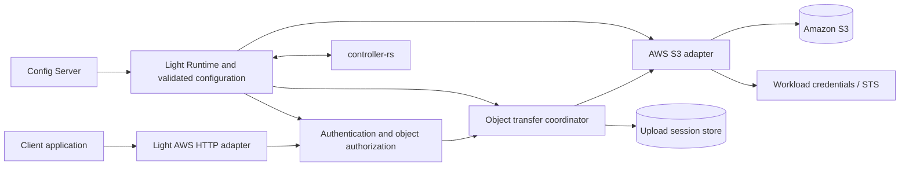

# Light AWS: managed AWS access, starting with S3

Status: proposed design for review; no implementation, deployment, or cloud qualification is implied.

Date: 2026-10-15.

## Recommendation

Create **`apps/light-aws` as a long-running Light Fabric application**, deployable as a sidecar or shared micro gateway. Deliver S3 object upload/download first. Package one application per cloud provider, with independently selectable service modules inside it. Keep the HTTP object-storage contract and transfer coordination independent of AWS, and put AWS SDK dependencies in AWS implementation crates.

This gives applications a language-neutral API without requiring them to implement AWS signing, STS credential refresh, or S3 multipart mechanics. A future `light-azure` or `light-gcp` can implement the same object API while linking only its own provider SDKs. A future AWS capability can be added to `light-aws` without forcing a separate product for every AWS service.

Reuse handlers through libraries and thin transport adapters. Do not build one universal cloud-service dispatcher: storage, messaging, secrets, and function invocation have different security, streaming, and failure contracts. Share infrastructure where semantics actually match.

Evaluate `light-pingora` first to maximize existing handler reuse. Before freezing the public and internal object-storage contracts, complete a bounded comparison of S3, Azure Blob Storage, Google Cloud Storage, and representative S3-compatible storage implementations. Implement S3 first; the comparison is contract design work, not a commitment to implement every provider.

## Customer requirement and design boundaries

Applications need to transfer files larger than 16 MB, authenticate using enterprise mechanisms supported by Light Fabric, and avoid AWS-specific application code. The proxy must obtain configuration from Config Server, register with `controller-rs`, and support consistent authorization, flow control, telemetry, and credential management.

The supplied “AWS STS Authentication - S3 invoker” material recommends direct S3 invocation from a gateway handler. This design adopts that direction, implemented in Rust with the AWS SDK for Rust. The Java SDK/library onboarding concerns in the material describe the customer's environment; they are not evidence that the Rust SDK or deployment artifact has organizational approval. Dependency, artifact repository, and operational approval remain delivery prerequisites.

The 16 MB figure is a customer workload threshold, not a universal S3 or HTTP limit. HTTP transfer encoding, browser `multipart/form-data`, AWS signed streaming payloads, and S3 multipart upload are different mechanisms. The public API uses binary HTTP bodies; the AWS adapter owns S3 multipart and SDK signing details.

This product is distinct from [Light Lambda](../light-lambda/design.md). Light Lambda addresses a policy Lambda invoking a business Lambda through an event-based ingress. Light AWS transfers bytes directly between HTTP clients and S3, without an intervening business Lambda. Do not extend the current Lambda work packages or infer that their event/body abstractions support large-file streaming.

## Packaging choices

| Choice | Advantages | Costs | Decision |
| --- | --- | --- | --- |
| One application containing all cloud providers | One distribution and routing surface | Broad SDK dependency closure, larger patching scope, coupled provider releases | Reject as the default distribution |
| One application per provider, optional service modules | Provider isolation, shared credentials/configuration, reusable service libraries | Requires consistent cross-provider contracts and deliberate feature management | Recommended |
| One application per cloud service | Smallest independently deployed unit | More binaries and repeated bootstrap/operational work | Allow deployment profiles when justified |
| Language-specific client wrapper | No proxy hop | Every language must adopt libraries and cloud security machinery | Does not satisfy the primary HTTP abstraction requirement |

The first release artifact should contain S3 and its required credential dependencies only. Proposed Cargo features such as `s3` and later `sqs` control optional service SDKs. A disabled runtime route alone does not remove a linked SDK. Verify feature combinations, dependency trees, artifact size, and SBOM in CI; avoid workspace feature unification accidentally activating every service. Do not promise a numerical footprint before measuring it.

One application per provider does not require deploying all enabled services together. Operators can run separate instances of the same product for S3 and another service, using distinct identities, limits, and release policies.

## Scope

The initial customer release includes:

- OAuth 2.0 bearer-token validation and Basic authentication through qualified Fabric policy adapters; API key, mTLS, or other existing mechanisms are enabled only after their integration passes the same authorization tests.
- Logical storage targets mapped to approved S3 buckets/prefixes and credential profiles.
- Streaming upload, download, and metadata lookup; version selection and single-range downloads.
- Resumable upload sessions with bounded parts, completion, status, cancellation, expiry, and orphan cleanup.
- Config Server bootstrap, controller registration, health/readiness, graceful draining, quotas, and redacted audit/metrics.

Initially exclude bucket administration, general object listing/deletion/copy, arbitrary AWS API forwarding, public S3 protocol emulation, and transparent provider replication/failover. Aborting an unfinished upload is included; deleting a completed object is a separate permission and API decision.

CDNs are a separate service category and are outside this design and its provider comparison. Cloudflare R2, if examined, is considered only as object storage through its S3-compatible API.

Presigned direct transfer is a later opt-in mode. It reduces proxy bandwidth but exposes a provider endpoint and a bearer capability, bypasses per-byte proxy controls, and changes the client's contract. It must not silently replace authenticated proxy transfers.

## Architecture and reuse



Proposed layout; these are design names, not existing implemented modules:

```text
apps/light-aws/                    composition, feature selection, packaging
crates/object-storage-core/        typed operations, capabilities, errors, limits
crates/object-transfer/            authorization binding, sessions, retry coordination
crates/aws-client-core/            AWS credentials, region and approved client profiles
crates/aws-s3/                     S3 SDK operations and provider error translation
frameworks/<transport>/...         thin HTTP handlers and body-stream adapters
```

`object-storage-core` must not depend on AWS SDK types, Pingora, Axum, or Lambda event types. It exposes bounded asynchronous body streams, cancellation, object metadata, opaque version identifiers, and explicit provider capabilities. Avoid a generic “execute service/action JSON” interface. Session storage uses an explicit atomic persistence interface, not an assumption that any generic cache supplies transactions or leases.

Use [Light Runtime](../../crate/light-runtime.md) for startup/shutdown and configuration, [Config Loader](../../crate/config-loader.md) for typed configuration, and [Portal Registry](../../design/controller-registry.md) for the existing controller protocol. Reuse existing JWT/Basic policies rather than inventing new credential validators. The inspected gateway currently composes policy with Pingora, so sharing a handler does not mean its transport-specific implementation can be plugged directly into Axum.

Evaluate **`light-pingora` first** as the service transport. Its existing authentication, authorization, correlation, rate-limiting, and telemetry handlers are reuse candidates within a Pingora application. Qualify each enabled handler for streaming routes; existing gateway behavior alone does not establish large-object compatibility. The S3 terminal handler serves the HTTP operation through the SDK rather than forwarding it as an ordinary upstream HTTP request.

Distinguish direct handler reuse within Pingora from sharing policy logic across frameworks. If `light-axum` is selected after the feasibility evaluation, reuse transport-independent policy functions through thin Axum adapters; do not assume Pingora handler types can be plugged into Axum. Keep provider operations and transfer coordination independent of either transport, and avoid broad handler extraction without a concrete reuse requirement.

The transport decision requires a spike through the real handler chain and SDK demonstrating upload/download backpressure, cancellation, bounded memory, error handling after response headers, and no hidden body collection. Reject incompatible whole-body handlers during configuration validation. Select Axum only if the evaluation establishes a concrete integration advantage and qualifies the required policy adapters. SDK clients should be reused by validated profile, not constructed per request.

Other Fabric products can compose the transfer service and AWS adapter with their own HTTP handlers. A Lambda product may reuse credential or S3 operation libraries for appropriately sized operations; that does not confer large-file streaming capability on its ingress.

## Two independent security boundaries

### Client to Light AWS

Validate the configured authentication mechanism, then produce one trusted principal containing tenant/application identity and granted permissions. Validate bearer issuer, audience, signature, expiry, and applicable token-use policy; opaque OAuth tokens require an explicitly supported introspection path. Basic authentication requires TLS, managed credentials, and a configured identity mapping. Never treat a caller-supplied tenant header as authenticated identity.

Route policy must specify accepted mechanisms and required combinations explicitly. A failed bearer credential must not fall back to a weaker mechanism. Reject ambiguous credential combinations unless the route deliberately defines their semantics. Whole-body authentication or transformation handlers must be rejected on streaming routes unless they have a qualified bounded-part implementation; buffering an entire object to verify a signature defeats the transfer contract.

Authorization is the intersection of principal permissions, logical-target policy, operation, object key/prefix, and deployment limits. Check before reading a large body, creating an S3 upload, or issuing a download. Recheck every resumable request, including status, completion, and abort. Sessions are bound to their authenticated owner/tenant and are not bearer capabilities by themselves.

### Light AWS to AWS

The proxy signs S3 requests using its own configured AWS identity. The client's enterprise access token is not forwarded to S3 or automatically exchanged through STS.

Support explicit credential profiles:

1. Workload role credentials supplied by the deployment environment, including supported ECS/EC2/EKS mechanisms.
2. `AssumeRole` from an authorized source identity for cross-account or target-specific access, with configured external ID/session policy where required.
3. `AssumeRoleWithWebIdentity` only when the configured token source, issuer, audience, and AWS trust relationship are explicitly established. An arbitrary inbound OAuth token is not such a source.

Use the SDK credential provider's expiry-aware refresh. Cache clients/credentials by the full security-relevant profile, including role, region, and session constraints; coalesce refresh to avoid STS storms. No request may supply a role ARN, source token file, endpoint, or credential override. Resolve the deployment's credential chain deliberately so unexpected environment credentials cannot silently change its identity.

Apply least-privilege IAM and bucket policies to the configured buckets/prefixes, multipart operations, version access, and KMS keys. SSE-KMS requires its own qualified IAM/key-policy permissions. Static access keys are a controlled fallback through managed secret references, never plaintext example configuration or public API fields. Never return AWS credentials to clients.

## Two object-storage API boundaries

Define both boundaries before implementing the first provider:

| Boundary | Responsibilities | Must not expose |
| --- | --- | --- |
| Client-facing HTTP API | Logical targets, binary upload/download, metadata, ranges, opaque versions, resumable sessions, stable errors and capabilities | Bucket/region requirements, role ARNs, provider SDK types, native upload identifiers |
| Internal provider interface | Typed read/write/metadata and upload-session operations, bounded asynchronous byte streams, cancellation, receipts, integrity information, capability and error mapping | HTTP framework request/session types or AWS SDK types in the shared contract |

The transfer coordinator owns enterprise authorization binding, admission, public session IDs, and durable orchestration. Provider adapters own native resource mapping, credentials/signing, SDK calls, and provider-specific transfer mechanics. Native upload identifiers and other sensitive resume material remain in protected server-side state. Do not require every adapter to implement S3-style numbered parts: the provider comparison must determine where sequential offsets, staged blocks, or ordered manifests require different internal primitives.

Specify a small common baseline and explicit optional capabilities for version selection, conditional operations, checksums, and resumable transfer behavior. Unsupported behavior returns a documented capability error before accepting the transfer. Capability information must describe the authorized logical target, not disclose infrastructure credentials or unrelated targets.

### Portable HTTP object contract

Use logical `target` names, such as `claim-documents`. Server configuration maps them to provider resources. An application supplies an opaque object key relative to its authorized namespace; it never needs a bucket name, region, role ARN, or SDK object. The same target name can be mapped differently per deployment.

Proposed versioned endpoints:

The numbered-part session endpoints below are provisional until the provider comparison confirms their mapping. If a provider needs ordered byte offsets, expose the constraint explicitly or revise the common session contract before release. Do not emulate portability through unbounded buffering or silently ignore requested part ordering/replacement semantics.

| Method and path | Purpose | Body/result |
| --- | --- | --- |
| `PUT /v1/storage/{target}/objects?key=...` | One-request upload | Binary body; committed object receipt |
| `GET /v1/storage/{target}/objects?key=...&version=...` | Download | Streamed binary response |
| `HEAD /v1/storage/{target}/objects?key=...&version=...` | Metadata | Length, content type, validators, supported range information |
| `POST /v1/storage/{target}/uploads` | Create resumable upload | Small JSON metadata; opaque upload ID and part constraints |
| `PUT /v1/storage/{target}/uploads/{id}/parts/{number}` | Upload/replace one part | Bounded binary body; part receipt |
| `GET /v1/storage/{target}/uploads/{id}` | Read upload status | Authorized state and paginated accepted-part metadata |
| `POST /v1/storage/{target}/uploads/{id}/complete` | Commit assembled object | Ordered part receipts; final object receipt or reconciliation status |
| `DELETE /v1/storage/{target}/uploads/{id}` | Abort unfinished upload | Idempotent terminal result |

Example create body:

```json
{
  "key": "2026/claim-123/evidence.pdf",
  "contentType": "application/pdf",
  "sizeBytes": 67108864
}
```

The response supplies `uploadId`, expiry, and validated minimum/maximum part size and maximum part count. Part requests include their length and the checksum selected by the contract. Object receipts contain the logical target/key, size, opaque version/validator where available, and an explicit checksum algorithm/value when verified. Do not present an S3 multipart ETag as a content MD5.

The raw material's `DIRECTION` becomes the HTTP operation. `BUCKET_FIELD` becomes the server-controlled target mapping; `KEY_FIELD` becomes `key`; `VERSION_ID_FIELD` becomes an optional opaque read version. Versions are returned by writes, not selected as a destination version by callers. A single POST with upload/download direction would hide HTTP semantics and complicate caching, ranges, and streaming. If a legacy client requires it, design a separate compatibility adapter after its exact wire contract is known.

Decode query values exactly once and apply identical key interpretation during authorization and SDK invocation. Keys are not filesystem paths: do not silently collapse slashes or dot segments. Define the allowed key grammar, UTF-8 byte limits, reserved control characters, and literal percent/plus handling in OpenAPI and adversarial tests. Reject duplicates for security-sensitive query fields. Construct a server-owned prefix and check namespace boundaries; do not use a naive string-prefix test that confuses `team-a/` with `team-ab/`.

Allowlist metadata and response headers, enforce byte/count limits, and sanitize content disposition. Never forward arbitrary `x-amz-*`, ACL, encryption, or endpoint settings from the caller. Provider-specific capabilities are explicit; unsupported version/range/checksum/conditional-write behavior produces a documented capability error, never silent degradation.

## Transfer behavior and resource limits

### One-request upload

Authenticate and reserve tenant/instance capacity before accepting the body. Use a replayable bounded upload for small objects and S3 multipart internally for larger or unknown-length streams. The SDK must receive bodies with known retry behavior; a live non-replayable client stream cannot simply be retried after it has been consumed.

Accumulate at most the configured number of bounded parts, send them with bounded concurrency, and stop reading when capacity is exhausted. Enforce actual received bytes even when `Content-Length` is missing or false. Reject declared oversize bodies early; abort partial uploads when runtime limits are exceeded. Never return success until completion is confirmed and its SDK result parsed.

A dropped one-request HTTP connection requires the client to restart the transfer; it is not automatically resumable. For expensive uploads, recommend the explicit session API. No unbounded disk spooling is allowed. If a replay spool is needed, define encrypted storage, quota, retention, and failure cleanup as part of the deployment contract.

### Resumable upload

Use a state machine such as `OPEN -> COMPLETING -> COMPLETED`, with `ABORTING -> ABORTED` and expiry handling. Persist the provider upload ID, owner/tenant, immutable target/profile binding, key, metadata, accepted part receipts/checksums, expiry, and final receipt in a durable shared store. Replicas require atomic transitions and leases; process memory and sticky routing are insufficient for restart-safe resume.

For the first implementation, prefer an owned PostgreSQL session store unless an existing store proves the required transactional semantics. A sidecar can use the same external store; a local durable mode would need its own restart and single-writer qualification and must not be advertised as replica-safe.

Each part must satisfy advertised S3 constraints, including the non-final part minimum and maximum part count. Use an illustrative 16 MiB preferred part size only as a starting point; select a size that fits the configured maximum object size and provider part-count limit. Verify current AWS limits against the pinned SDK/service documentation before fixing supported bounds. S3 multipart is not HTTP chunked encoding or MIME multipart.

Bind idempotency keys for create/complete to tenant, operation, and request fingerprint with bounded retention; conflicting reuse returns `409`. The same part number and checksum can be retried safely. Serialize same-part replacement so a delayed request cannot overwrite a newer accepted part. Freeze the ordered manifest during completion and block concurrent part updates/abort with transactional state checks.

SDK calls and database writes cannot share one transaction. Persist operation intent, fence concurrent workers, and reconcile uncertain results. An S3 completion timeout may mean the object was committed: do not blindly repeat a new upload. Use a server-generated upload marker and qualified object/version checks to distinguish the intended commit from unrelated writes; retain an indeterminate state if proof is unavailable. Return a stable operation status for polling rather than a false success/failure. Define equivalent handling for an uncertain simple PUT and do not claim exactly-once writes.

Expired/cancelled sessions trigger bounded `AbortMultipartUpload` cleanup, retry, and audit. Configure bucket lifecycle cleanup as a backstop for orphaned uploads, including crashes after S3 create but before recording its upload ID. Reconcile database/S3 disagreement and alert on cleanup failures. A completed object's visibility and same-key overwrite policy must be explicit; default to rejecting overlapping proxy writes while qualifying external-writer and versioning behavior separately.

### Download

Stream the S3 response with backpressure; cancel/release upstream resources when the client disconnects. Support a single byte range with `206`, correct `Content-Range`, and `416` for invalid ranges; reject unsupported multi-range requests explicitly. Obtain metadata from the same GET response wherever possible. If a preflight HEAD is necessary, bind the following GET to a version/validator to avoid a race with overwrites.

Forward qualified validators and conditional-read semantics. Do not change byte encoding or content length through response middleware. Once headers/body bytes have been sent, an upstream failure terminates the stream and records an incomplete transfer; it cannot become a JSON error or transparent full-body retry. Client resume should use a stable version/validator to avoid combining bytes from different object versions.

### Capacity and timeouts

Limit active transfers, per-tenant concurrency, upload sessions, part concurrency, body/metadata sizes, bandwidth, pending requests, and any spool space. Approximate upload buffer demand is `active uploads × buffered parts per upload × part size`, plus SDK/transport/TLS overhead. For example, 32 uploads with two 16 MiB buffers already require about 1 GiB before overhead; these are sizing illustrations, not proposed defaults.

Define connect, read-idle, write-idle, per-part, and whole-request deadlines separately from session lifetime. Align ingress/LB/service-mesh limits with the service. An ordinary load balancer can front a container without inheriting ALB Lambda-target payload limits, but still has its own connection and timeout behavior. Measure the deployed path rather than promising a fixed hop count or unlimited file size.

## Configuration and controller integration

Reuse `server.yml`, `startup.yml`, `client.yml`, and `portal-registry.yml` conventions. Introduce a proposed typed `aws.yml` and `object-storage.yml`; publish schemas and Config Server definitions with the implementation. The following illustrates intent, not accepted runtime syntax:

```yaml
# Proposed configuration; secret material is resolved separately.
aws:
  profiles:
    claims-role:
      region: ca-central-1
      credentials:
        mode: workload
objectStorage:
  targets:
    claim-documents:
      provider: s3
      profile: claims-role
      bucket: example-private-claims
      prefix: claims/
      allowedOperations: [read, metadata, upload]
      authorizationPolicy: claims-document-access
      encryption: bucket-policy
  transfers:
    preferredPartSizeBytes: 16777216
    maxBufferedPartsPerUpload: 2
  sessions:
    store: postgres
    connectionSecretRef: light-aws/session-store
```

Required limits, token policy, region/endpoint policy, target authorization, and session persistence must validate before readiness. Example omissions are not permissive defaults. Keep full SDK tuning behind typed, reviewed settings; exposing every SDK option would also expose credential/endpoint bypasses and unstable implementation details. Custom S3 endpoints require administrator allowlists, TLS validation, and a separate compatibility profile; “S3-compatible” does not establish parity for STS, KMS, checksums, or multipart behavior.

Bootstrap through Config Server using the existing runtime identity and TLS trust, then compile one validated immutable snapshot of targets, credentials, policy, and limits. Publish it atomically; reject invalid reloads while retaining the last valid snapshot. Persist each session's target/profile/config generation so reload cannot redirect an upload into another bucket. Pin resource mapping for active transfers while rechecking current authorization on new session requests; removal/revocation must deny further work and initiate authorized cleanup. Credential refresh may rotate credentials without changing the bound resource identity.

Register the service identity, version, address, environment, and supported capabilities with `controller-rs` using `portal-registry`, including its established heartbeat/reconnect behavior. Registration is control-plane connectivity, not proof of S3 permission or transfer readiness. Expose separate readiness for valid configuration, credential availability, session-store health, and any configured registration requirement. Avoid a synchronous S3 request on every health probe.

Document last-known-good operation during Config Server/controller outages with an explicit maximum staleness policy; fail closed at cold start without required configuration. Drain new work on shutdown, allow bounded in-flight completion, preserve resumable state, and cancel/clean up unfinished one-request uploads. Administrative endpoints require their own restricted access.

## Errors, audit, and observability

Normalize errors into stable codes with request correlation and a retryability indication. Distinguish authentication (`401`), authorization (`403`), concealed/missing object (`404` per policy), conflicts (`409`), failed conditions (`412`), size limits (`413`), range errors (`416`), unsupported capabilities, admission limits (`429`), and unavailable upstream/credentials (`502`/`503`/`504` as appropriate). Upstream IAM denial is not automatically a client OAuth failure. Apply a consistent existence-concealment policy and never echo raw AWS exception bodies.

Use bounded retries with jitter only for classified transient failures and replayable operations. Do not multiply SDK and application retry budgets. Emit byte counts, active transfers, part latency/retries, credential-refresh failures, session expiry, orphan cleanup, and incomplete downloads. Track time to first byte separately from complete transfer time.

Audit principal/tenant, logical target, operation, decision, config generation, outcome, bytes, and correlation ID. Apply a documented privacy policy to object keys and filenames; use redaction or approved hashes where appropriate. Do not log bodies, Basic passwords, bearer tokens, STS credentials, signed URLs, or unrestricted user metadata. Do not use object keys/upload IDs as metric labels. Define audit backpressure/failure behavior before production and distinguish admission from confirmed completion.

## Additional providers and AWS services

### Bounded storage-provider comparison

Complete this survey before freezing OpenAPI and the internal provider interface. The entries below identify questions to investigate, not completed compatibility findings.

| Provider/API | Focus of comparison |
| --- | --- |
| Amazon S3 | Multipart create/upload/complete/abort, part replacement, versions, conditional operations, checksums, uncertain completion recovery |
| Azure Blob Storage | Block staging and commit, block identifiers/order, versions, leases/preconditions, integrity and uncommitted-block cleanup |
| Google Cloud Storage | Resumable sessions and acknowledged offsets, chunk ordering/retry, generations/preconditions, integrity and cancellation |
| Cloudflare R2 and MinIO S3-compatible APIs | Supported S3 subset and differences in multipart, versions, checksums, conditional behavior, credentials, and cleanup |

Record a capability matrix covering streaming and backpressure; object/part limits; known and unknown lengths; sequential versus parallel chunks; replacement and replay; resume/status/expiry; commit atomicity and indeterminate outcomes; ranges and conditional reads/writes; versions; metadata/key rules; checksums; and error mapping. Keep provider credential and encryption settings in provider-specific configuration.

For every proposed common operation, record whether it maps directly, needs a bounded adapter strategy, or is unsupported. Include documentation references and API/SDK versions, and use focused experiments where documentation leaves semantics uncertain. Review the matrix to decide the baseline, optional capabilities, and any changes to the provisional multipart endpoints. The deliverables are the matrix, reviewed OpenAPI, and a typed provider-interface specification; implementation and operational qualification remain S3-only initially.

### Expansion after S3

Build the abstraction around object storage first. Add Azure Blob Storage or Google Cloud Storage only with contract tests for streaming, range/version behavior, metadata, integrity, and resumable commit. Capability discovery and explicit unsupported results are preferable to pretending every provider has S3 semantics. Session handles remain bound to their original provider; changing target mapping is not migration of data or in-flight sessions.

Within AWS, add SQS, SNS, EventBridge, or other services only against a funded use case. Each gets a typed contract, IAM policy, optional SDK dependency, error/retry semantics, and independent qualification. Messaging particularly needs its own acknowledgement, ordering, deduplication, and visibility contracts. Reuse credentials, config, auth, and telemetry; do not route arbitrary AWS actions through a privileged generic endpoint. Lambda invocation must coordinate with the existing Light Lambda product rather than duplicate its event/parity obligations.

## Delivery and acceptance gates

| Gate | Deliverable and required evidence |
| --- | --- |
| 0: contract and deployment decisions | Complete the bounded storage-provider capability matrix; review HTTP/OpenAPI and internal provider contracts, including part versus offset semantics; agree auth modes, key/overwrite semantics, expected size/concurrency, session persistence, AWS trust model, retention, and dependencies |
| 1: streaming feasibility | Evaluate Pingora first with real handlers and SDK; record transport selection and per-handler streaming compatibility; uploads/downloads larger than 16 MB, slow peers, cancellation, bounded RSS, no full-body buffering, qualified auth integration |
| 2: component contract | Simulated S3/STS failures; IAM/target isolation, decoding attacks, part retry/replacement, completion races, uncertain commit recovery, reload/revocation, crash/cleanup tests |
| 3: AWS integration | Dedicated test account/buckets/roles; workload identity and STS expiry/refresh, cross-account access if required, multipart, checksums, versions, ranges, SSE-KMS, lifecycle cleanup, real error mapping |
| 4: deployment qualification | Sidecar and shared replica profiles through intended ingress; Config Server/controller outages, rolling restart, session-store failure, quotas, performance/egress cost and audit/privacy review |

Emulators and local mocks are useful component proof; they do not qualify real IAM, STS trust, KMS, or deployment networking. Record exact artifacts/configurations and test results separately for local, AWS integration, and customer deployment evidence. A later provider or AWS service repeats the relevant gates.

## Decisions to settle before implementation

1. Sidecar, shared gateway, or both for the first customer; deployment platform and ingress timeout requirements.
2. Maximum file size, peak concurrency/throughput, typical transfer duration, and whether clients require resume across process/replica restart.
3. Logical-target/prefix tenancy model, allowed filenames/keys, overwrite semantics, versioning, metadata/privacy, and retention requirements.
4. OAuth issuers/audiences and Basic credential ownership; required additional auth schemes and their streaming compatibility.
5. AWS account/region, source workload identity, cross-account roles, KMS requirements, private endpoint access, and SDK/artifact approval.
6. PostgreSQL ownership for resumable sessions, cleanup SLOs, audit durability, and operational ownership for the proxy's bandwidth/cost.

Recommended default remains: one provider application, S3-only initial artifact, Pingora evaluated first for handler reuse, portable HTTP and internal provider contracts informed by a bounded storage-provider comparison, and a direct streaming data path. Expand service scope when a concrete requirement justifies its contract and operational cost.

## References and evidence boundary

- Customer-supplied “AWS STS Authentication - S3 invoker,” attributed to Diogo Fekete in the supplied material.
- Existing Fabric [handler-chain design](../../design/handler-chain.md), [Light Axum](../../framework/light-axum.md), [Light Runtime](../../crate/light-runtime.md), [Config Loader](../../crate/config-loader.md), and [controller registry](../../design/controller-registry.md) documentation.
- Current source integration anchors: `apps/light-gateway/src/main.rs`, `frameworks/light-pingora/src/basic_auth.rs`, `frameworks/light-pingora/src/unified_security.rs`, and `crates/light-runtime/src/runtime.rs`. Existing modules establish reuse candidates, not completion of Light AWS adapters.
- AWS implementation references to verify when pinning the SDK: [S3 multipart overview](https://docs.aws.amazon.com/AmazonS3/latest/userguide/mpuoverview.html), [multipart limits](https://docs.aws.amazon.com/AmazonS3/latest/userguide/qfacts.html), [Rust credential providers](https://docs.aws.amazon.com/sdk-for-rust/latest/dg/credproviders.html), and [STS web identity](https://docs.aws.amazon.com/STS/latest/APIReference/API_AssumeRoleWithWebIdentity.html). These links are reference targets; no live AWS verification was performed for this draft.
