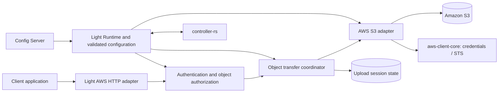

# Light AWS: managed AWS access, starting with S3

Status: proposed design for review; no implementation, deployment, or cloud qualification is implied. Field names, endpoints, crates, and configuration schemas below are proposed, not existing runtime contracts.

Date: 2026-10-16.

## Recommendation

Create **`apps/light-aws` as a long-running Light Fabric application**, deployable as a sidecar or shared micro gateway. Deliver S3 object upload/download first. Package one application per cloud provider, with independently selectable service modules inside it. Keep the HTTP object-storage contract and transfer coordination independent of AWS, and put AWS SDK dependencies in AWS implementation crates.

This gives applications a language-neutral API without requiring them to implement AWS signing, STS credential refresh, or S3 multipart mechanics. A future `light-azure` or `light-gcp` can implement the same object API while linking only its own provider SDKs. A future AWS capability can be added to `light-aws` without forcing a separate product for every AWS service.

Reuse handlers through libraries and thin transport adapters. Do not build one universal cloud-service dispatcher: storage, messaging, secrets, and function invocation have different security, streaming, and failure contracts.

Build on Pingora, but account for where the reusable code actually is. `light-pingora` exports policy functions and configuration loaders; the **handler chain that orders and executes them lives in `apps/light-gateway`**. A standalone `apps/light-aws` therefore requires extracting that orchestration into `light-pingora` first, or hosting the S3 module inside `light-gateway`. Gate 1 measures both options and selects one; see [Transport and reuse](#transport-and-reuse).

Before freezing the public and internal object-storage contracts, complete a bounded comparison of S3, Azure Blob Storage, Google Cloud Storage, and representative S3-compatible implementations. Implement S3 first; the comparison is contract design work, not a commitment to implement every provider.

## Customer requirement and design boundaries

Applications need to transfer files larger than 16 MB, authenticate using enterprise mechanisms supported by Light Fabric, and avoid AWS-specific application code. The proxy must obtain configuration from Config Server, register with `controller-rs`, and support consistent authorization, flow control, telemetry, and credential management.

The supplied “AWS STS Authentication - S3 invoker” material recommends direct S3 invocation from a gateway handler. This design adopts that direction, implemented in Rust with the AWS SDK for Rust. The workspace already pins `aws-config` and `aws-sdk-bedrockruntime` for the Bedrock model provider, which is a technical precedent but not organizational approval for the S3/STS crates or the deployment artifact. Dependency, artifact repository, and operational approval remain delivery prerequisites.

The 16 MB figure is a customer workload threshold, not a universal S3 or HTTP limit. HTTP transfer encoding, browser `multipart/form-data`, AWS signed streaming payloads, and S3 multipart upload are different mechanisms. The public API uses binary HTTP bodies; the AWS adapter owns S3 multipart and SDK signing details.

Light AWS is distinct from [Light Lambda](../light-lambda/design.md), which hosts a policy gateway inside AWS Lambda. Light AWS transfers bytes directly between HTTP clients and S3 and does not extend the Lambda work packages or imply that their event/body abstractions support large-file streaming. Whether `light-aws` should later *call* Lambda as an optional module is a separate [Lambda invocation evaluation](lambda-invocation.md).

## Packaging choices

| Choice | Advantages | Costs | Decision |
| --- | --- | --- | --- |
| One application containing all cloud providers | One distribution and routing surface | Broad SDK dependency closure, larger patching scope, coupled provider releases | Reject as the default distribution |
| One application per provider, optional service modules | Provider isolation, shared credentials/configuration, reusable service libraries | Requires extracting the gateway handler chain; consistent cross-provider contracts; deliberate feature management | Recommended target |
| S3 module inside `light-gateway`, behind an off-by-default Cargo feature | Reuses the complete existing handler chain, admission, Config Server/controller integration, and release pipeline; still deployable as a sidecar | Couples S3 releases to the gateway; adds AWS SDK closure to gateway builds that enable it; grows an already large `main.rs`; mixes object-transfer limits with proxy routing | Fallback if Gate 1 shows extraction is not bounded |
| One application per cloud service | Smallest independently deployed unit | More binaries and repeated bootstrap/operational work | Allow deployment profiles when justified |
| Language-specific client wrapper | No proxy hop | Every language must adopt libraries and cloud security machinery | Does not satisfy the primary HTTP abstraction requirement |

The first release artifact should contain S3 and its required credential dependencies only. Cargo features such as `s3` and later `sqs` control optional service SDKs; a disabled runtime route alone does not remove a linked SDK. Verify feature combinations, dependency trees, artifact size, and SBOM in CI, and avoid workspace feature unification accidentally activating every service. Do not promise a numerical footprint before measuring it.

One application per provider does not require deploying all enabled services together. Operators can run separate instances of the same product for S3 and another service, using distinct identities, limits, and release policies.

## Scope

The initial customer release includes:

- OAuth 2.0 bearer-token validation and Basic authentication through qualified Fabric policy adapters; API key, mTLS, or other existing mechanisms are enabled only after their integration passes the same authorization tests.
- Logical storage targets mapped to approved S3 buckets/prefixes and credential profiles.
- Streaming upload, download, and metadata lookup; version selection and single-range downloads.
- Resumable upload sessions with bounded parts, completion, status, cancellation, expiry, and orphan cleanup.
- Config Server bootstrap, controller registration, health/readiness, graceful draining, quotas, and redacted audit/metrics.

Initially exclude bucket administration, general object listing/deletion/copy, arbitrary AWS API forwarding, public S3 protocol emulation, transparent provider replication/failover, and CDNs. Aborting an unfinished upload is included; deleting a completed object is a separate permission and API decision. Cloudflare R2, if examined, is considered only as object storage through its S3-compatible API. Content scanning (malware/DLP) is not provided by the proxy; whether the customer requires it inline or post-commit is a Gate 0 decision.

Presigned direct transfer is a later opt-in mode. It reduces proxy bandwidth but exposes a provider endpoint and a bearer capability, bypasses per-byte proxy controls, and changes the client's contract. It must not silently replace authenticated proxy transfers.

## Architecture and reuse



Proposed layout:

```text
apps/light-aws/                    composition, feature selection, packaging
crates/object-storage-core/        typed operations, capabilities, errors, limits
crates/object-transfer/            authorization binding, sessions, retry coordination
crates/aws-client-core/            AWS credential profiles, STS, region and approved client profiles
crates/aws-s3/                     S3 SDK operations and provider error translation
frameworks/light-pingora/...       extracted handler chain; thin streaming HTTP handlers
```

`object-storage-core` must not depend on AWS SDK types, Pingora, Axum, or Lambda event types. It exposes bounded asynchronous body streams, cancellation, object metadata, opaque version identifiers, and explicit provider capabilities. Avoid a generic “execute service/action JSON” interface. Session state uses an explicit persistence interface, not an assumption that a generic cache supplies transactions or leases.

Use [Light Runtime](../../crate/light-runtime.md) for startup/shutdown and configuration, [Config Loader](../../crate/config-loader.md) for typed configuration, and [Portal Registry](../../design/controller-registry.md) for the existing controller protocol. Reuse existing JWT/Basic policies rather than inventing new credential validators.

### Transport and reuse

What exists at revision `3902eae`:

- **Reusable today:** `light-pingora` exports policy functions and loaders that the gateway already calls, including `verify_jwt_request`, `verify_basic_auth`, `verify_unified_security`, `check_rate_limit`, `apply_correlation_request`, `AccessControlRuntime`, and the corresponding `load_*` configuration functions. It also has a `StreamingPolicy` for proxied response streams, whose request-time and idle-timeout settings are a reference for transfer deadlines but not a large-upload mechanism.
- **Not reusable without extraction:** the `PingoraHandler` trait carries only an identifier. Handler ordering, admission, correlation, security, ACL, and dispatch are implemented in the single `impl ProxyHttp for GatewayProxy` in `apps/light-gateway/src/main.rs`. A new Pingora application gets the building blocks, not the chain.
- **Body handling is whole-body:** the gateway's `read_bounded_request_body` and `read_bounded_request_body_with_rate` accumulate a `Vec<u8>`, and HMAC verification defaults to a 16 MiB body limit. These are correct for their routes and incompatible with S3 transfer routes. Streaming S3 handlers are new code.

Gate 1 compares two paths with a spike through the real policy functions and the SDK:

1. **Extract, then build `apps/light-aws`.** Move the request-phase orchestration out of `GatewayProxy` into `light-pingora` as a reusable chain that both applications call. Prove unchanged gateway behavior with the existing gateway test suites before `light-aws` depends on it. Extract only the phases Light AWS needs: admission, correlation, authentication, authorization, rate limiting, and metrics.
2. **S3 module in `light-gateway`.** Add a terminal S3 handler behind an off-by-default feature, reusing the chain in place.

Select path 1 if the extraction is bounded and does not change gateway behavior; otherwise ship path 2 for the first customer and record the extraction as follow-up work. Both paths require the same streaming evidence: upload/download backpressure, cancellation, bounded memory, `Expect: 100-continue` handling, error handling after response headers, and no hidden body collection. Reject whole-body handlers on streaming routes during configuration validation. The S3 terminal handler serves the operation through the SDK rather than forwarding it as an upstream HTTP request.

Axum is not the default. Consider `light-axum` only if Gate 1 shows a concrete integration advantage; it would reuse transport-independent policy functions through thin adapters, not Pingora handler types.

Other Fabric products can compose the transfer service and AWS adapter with their own HTTP handlers. A Lambda product may reuse credential or S3 operation libraries for appropriately sized operations; that does not confer large-file streaming capability on its ingress.

### Shared AWS client crate

Three places would otherwise own AWS credentials: this design, Light Lambda's proposed `crates/serverless-aws` ("SDK Invoke backend, AWS error mapping and credentials"), and the existing Bedrock provider in `crates/model-provider`, which builds its client from `aws_config::defaults(...)`, the implicit default credential chain.

Make `crates/aws-client-core` the single owner of AWS credential profiles, STS acquisition/refresh, credential-provider caching, and validated client configuration (region, endpoint policy, timeouts, retry policy, and HTTP client). It depends only on `aws-config`, `aws-sdk-sts`, and the shared SDK runtime/type crates, never on a service SDK; CI enforces this with a dependency-tree check. Service crates (`aws-s3`, Light Lambda's `serverless-aws`, and later SQS/EventBridge) depend on it, then construct and cache their own typed SDK clients from the shared configuration and own their service operations and error translation. Enabling one service therefore never links another service's SDK. The Light Lambda design's crate table needs a matching amendment before either crate is built. Migrating the Bedrock provider's default-chain option to a named profile is recommended but not a prerequisite for S3.

New SDK crates (`aws-sdk-s3`, `aws-sdk-sts`) must resolve against the workspace's exact `aws-config` pin; select versions that share its smithy runtime rather than introducing a second runtime into the dependency tree.

## Two independent security boundaries

### Client to Light AWS

Validate the configured authentication mechanism, then produce one trusted principal containing tenant/application identity and granted permissions. Validate bearer issuer, audience, signature, expiry, and applicable token-use policy; opaque OAuth tokens require an explicitly supported introspection path. Basic authentication requires TLS, managed credentials, and a configured identity mapping. Never treat a caller-supplied tenant header as authenticated identity.

Route policy must specify accepted mechanisms and required combinations explicitly. A failed bearer credential must not fall back to a weaker mechanism. Reject ambiguous credential combinations unless the route deliberately defines their semantics. Whole-body authentication or transformation handlers, including the current HMAC verifier, must be rejected on streaming routes unless they have a qualified bounded-part implementation; buffering an entire object to verify a signature defeats the transfer contract.

Authorization is the intersection of principal permissions, logical-target policy, operation, object key/prefix, and deployment limits. Check before reading a large body, creating an S3 upload, acquiring target-role credentials, or issuing a download, and **recheck on every resumable-session request**, including status, completion, and abort. Sessions are bound to their authenticated owner/tenant and are never bearer capabilities by themselves.

### Light AWS to AWS

The proxy signs S3 requests using its own configured AWS identity. The client's enterprise access token is not forwarded to S3 or automatically exchanged through STS. No request may supply a role ARN, profile, bucket, source token file, endpoint, or credential override. Never return AWS credentials to clients.

Supported credential modes:

1. **`workload`:** credentials supplied by the deployment environment through a qualified ECS/EC2/EKS mechanism, used directly when that identity already holds the target permissions.
2. **`assumeRole`:** a source profile's credentials sign an STS `AssumeRole` call for cross-account or target-specific access, with configured external ID/session policy where required.
3. **`assumeRoleWithWebIdentity`:** only when the configured token source, issuer, audience, and AWS trust relationship are explicitly established. STS validates that federated token against the role's OIDC trust conditions. An arbitrary inbound OAuth token is never such a source.

Resolve the credential chain deliberately: each profile names its mode, so unexpected environment credentials cannot silently change the deployment's identity. Static access keys are a controlled fallback through managed secret references, never plaintext example configuration or public API fields.

Apply least-privilege IAM and bucket policies scoped to the configured buckets/prefixes and to the precise S3 actions used for read, version access, upload, multipart listing/cleanup, and reconciliation. SSE-KMS transfers additionally require the relevant KMS permissions and key-policy trust.

## Service bindings and credential profiles

Map an inbound route to a configured **service binding**, which references an AWS credential profile. The profile owns the role ARN and credential-acquisition settings; the binding owns the service, allowed resource, operations, and authorization policy. This supports additional AWS services without making a path prefix an authorization mechanism or creating a generic privileged AWS dispatcher.

```text
Canonical route -> authorized service binding -> credential profile -> AWS role
                                            -> service/resource/operation
```

For S3, the logical target is the public name of its storage binding. Credential profiles live in `aws.yml`, storage bindings in `object-storage.yml`, and route/handler references in `handler.yml`:

```yaml
# aws.yml — proposed schema; secret material is resolved separately.
profiles:
  claims-storage:
    region: ca-central-1
    credentials:
      mode: assumeRole
      sourceProfile: workload-source
      roleArn: arn:aws:iam::222222222222:role/claims-storage
      externalIdSecretRef: aws/claims-external-id
      durationSeconds: 3600
  workload-source:
    region: ca-central-1
    credentials:
      mode: workload
```

The `targets` map in `object-storage.yml` (see [Configuration](#configuration-and-controller-integration)) is authoritative for storage bindings; do not maintain a duplicate `bindings` map. Conceptually, `handler.yml` connects `/v1/storage/claim-documents` to the storage handler and target `claim-documents`; its exact syntax must follow the existing handler-chain/routing contract rather than introduce a competing route registry. Validate route/target/profile consistency and reject source-profile cycles at configuration load.

Match canonical paths at segment boundaries: `/v1/storage/claim-documents` must not match `/v1/storage/claim-documents-other`. Define normalization once for both routing and authorization, reject ambiguous mappings, and dispatch only documented methods/subpaths within the binding.

### AssumeRole and S3 request sequence

1. Authenticate the inbound request, establish the trusted principal, resolve the binding, and authorize its operation/resource.
2. Resolve the source profile's workload credentials. The role ARN names a destination identity; it is not a credential and cannot obtain an STS session on its own.
3. Sign an STS `AssumeRole` request with the source credentials, supplying the configured `RoleArn`, a generated bounded `RoleSessionName`, the approved duration, and any configured external ID, session policy, source identity, or session tags. Only trusted server-side policy derives session attributes; callers cannot inject privilege-bearing tags. Session policies only restrict the role's permissions.
4. STS evaluates the source identity's `sts:AssumeRole` permission on the target ARN and the target role's trust policy, including the external ID and any identity/tag conditions. An external ID mitigates confused-deputy risk; it does not replace source credentials or application authorization.
5. STS returns temporary credentials and an expiration. Keep them in the server-side refreshable provider; never return them or persist them in session state.
6. The S3 SDK signs the operation with SigV4 and the session token. The assumed role's permissions, bucket policy, organization/boundary/session policies, and KMS policies determine whether it succeeds.

Inability to obtain the configured role is an upstream/configuration failure, not evidence that the client's OAuth token is invalid. Map it without exposing raw credential or policy material.

### Credential caching, refresh, and reload

STS is not called per file or part. `aws-client-core` caches refreshable credential providers by the full security-relevant identity: source profile and its generation, target role, external-ID reference/version, session policy, source identity/tags, and STS endpoint. Each service crate caches its typed clients by that credential identity plus service endpoint/region and its other client settings. When session constraints vary by trusted tenant/principal, include them in the key; never share a broader session across authorization contexts.

Refresh before expiry with a safety window and coalesce concurrent refreshes to avoid STS storms. Respect the role's maximum session duration and role-chaining limits; `3600` above is an example, not a guarantee. On refresh failure, existing credentials may be used only while valid and consistent with current revocation policy; otherwise fail closed. Bound retries and never fall back to a broader role or unexpected credential source.

A long multipart upload can sign later parts with refreshed credentials for the same bound role/resource; refresh does not make a consumed request body replayable. Session state records binding identity and config generation, never STS secrets. A reload must not silently change an active upload's role, bucket, or prefix: retain its approved binding or explicitly revoke it, with cleanup through an authorized identity.

### Extensibility to other AWS services

| Route example | Service binding | Credential profile | Restricted resource |
| --- | --- | --- | --- |
| `/v1/storage/claim-documents` | S3 object storage | `claims-storage` | Bucket/prefix |
| `/v1/messaging/claims-events` | SQS messaging | `claims-messaging` | Queue |
| `/v1/events/claims` | EventBridge publishing | `claims-events` | Event bus |

These future routes are examples, not initial-release endpoints. Each service keeps its own typed operations and handlers while reusing `aws-client-core`. Prefer roles separated by privilege boundary; share a profile only where resource permissions and session constraints are intentionally equivalent. A common path prefix never implies permission to invoke every service under the role.

## Object-storage API boundaries

Define both boundaries before implementing the first provider:

| Boundary | Responsibilities | Must not expose |
| --- | --- | --- |
| Client-facing HTTP API | Logical targets, binary upload/download, metadata, ranges, opaque versions, resumable sessions, stable errors and capabilities | Bucket/region requirements, role ARNs, provider SDK types, native upload identifiers |
| Internal provider interface | Typed read/write/metadata and upload-session operations, bounded asynchronous byte streams, cancellation, receipts, integrity information, capability and error mapping | HTTP framework request/session types or AWS SDK types in the shared contract |

The transfer coordinator owns enterprise authorization binding, admission, public session IDs, and durable orchestration. Provider adapters own native resource mapping, credentials/signing, SDK calls, and provider-specific transfer mechanics. Native upload identifiers and other sensitive resume material never reach the client in readable form. Do not require every adapter to implement S3-style numbered parts: the provider comparison determines where sequential offsets, staged blocks, or ordered manifests need different internal primitives.

Specify a small common baseline and explicit optional capabilities for version selection, conditional operations, checksums, and resumable transfer behavior. Unsupported behavior returns a documented capability error before accepting the transfer, never silent degradation. Capability information describes only the authorized logical target.

### Portable HTTP object contract

Use logical `target` names, such as `claim-documents`, mapped by server configuration to provider resources. An application supplies an opaque object key relative to its authorized namespace; it never needs a bucket name, region, role ARN, or SDK object. The same target name can be mapped differently per deployment.

The numbered-part session endpoints are provisional until the provider comparison confirms their mapping. If a provider needs ordered byte offsets, expose the constraint explicitly or revise the session contract before release; do not emulate portability through unbounded buffering or silently ignore part ordering/replacement semantics.

| Method and path | Purpose | Body/result |
| --- | --- | --- |
| `GET /v1/storage/{target}` | Capabilities | Authorized operations, size/part limits, checksum algorithms, version/range/conditional support |
| `PUT /v1/storage/{target}/objects?key=...` | One-request upload | Binary body and required `Operation-Key`; committed object receipt, or `202` with an operation reference when the outcome is uncertain |
| `GET /v1/storage/{target}/objects?key=...&version=...` | Download | Streamed binary response |
| `HEAD /v1/storage/{target}/objects?key=...&version=...` | Metadata | Length, content type, validators, checksum, range support |
| `POST /v1/storage/{target}/uploads` | Create resumable upload | Required `Operation-Key`, bound to the session; small JSON metadata; opaque upload ID and part constraints |
| `PUT /v1/storage/{target}/uploads/{id}/parts/{number}` | Upload/replace one part | Bounded binary body with checksum; part receipt |
| `GET /v1/storage/{target}/uploads/{id}` | Upload status | Authorized state and paginated accepted-part metadata |
| `POST /v1/storage/{target}/uploads/{id}/complete` | Commit assembled object | The session's bound `Operation-Key` and the client's expected part list; final object receipt, or `202` with an operation reference |
| `DELETE /v1/storage/{target}/uploads/{id}` | Abort unfinished upload | Idempotent terminal result |
| `GET /v1/storage/{target}/operations/{operationKey}?key=...` | Resolve an uncertain write (read-only) | `committed`, `indeterminate`, or, provisionally and only with the PostgreSQL store, `not-committed`; receipt when committed; see [Uncertain write outcomes](#uncertain-write-outcomes) |

Example create body:

```json
{
  "key": "2026/claim-123/evidence.pdf",
  "contentType": "application/pdf",
  "sizeBytes": 67108864
}
```

The response supplies `uploadId`, expiry, and validated minimum/maximum part size and maximum part count. Object receipts contain the logical target/key, size, opaque version/validator where available, and an explicit checksum algorithm/value when verified. Do not present an S3 multipart ETag as a content MD5.

**Completion authority.** The server's record of accepted parts, confirmed against S3 `ListParts`, is authoritative. The client's part list is a confirmation: any mismatch in part numbers, sizes, or checksums returns `409` with the server's view, and nothing is committed.

**Checksums.** The algorithm is a Gate 0 decision because it fixes receipt format and provider portability. S3 distinguishes full-object checksums from composite (checksum-of-part-checksums) values for multipart objects and supports a different algorithm set for each; Azure and GCS offer different sets again. The candidate default is a full-object CRC-family checksum computed by the proxy for every transfer, plus per-part checksums for resumable uploads; a customer requirement for SHA-256 evidence integrity changes that choice. Verify supported combinations against the pinned SDK.

The raw material's `DIRECTION` becomes the HTTP operation. `BUCKET_FIELD` becomes the server-controlled target mapping; `KEY_FIELD` becomes `key`; `VERSION_ID_FIELD` becomes an optional opaque read version. Versions are returned by writes, not selected as a destination by callers. A single POST with upload/download direction would hide HTTP semantics and complicate caching, ranges, and streaming. If a legacy client requires it, design a separate compatibility adapter after its exact wire contract is known.

Decode query values exactly once and apply identical key interpretation during authorization and SDK invocation. Keys are not filesystem paths: do not collapse slashes or dot segments. Define the allowed key grammar, UTF-8 byte limits, reserved control characters, and literal percent/plus handling in OpenAPI and adversarial tests. Reject duplicate security-sensitive query fields. Construct a server-owned prefix and check namespace boundaries; a naive string-prefix test confuses `team-a/` with `team-ab/`.

Allowlist metadata and response headers, enforce byte/count limits, and sanitize content disposition. Never forward arbitrary `x-amz-*`, ACL, encryption, or endpoint settings from the caller.

## Transfer behavior and resource limits

### Write semantics common to all uploads

**Overwrite.** The default policy rejects writes to an existing key. Enforce it in S3 itself with a conditional write (`If-None-Match: *` on `PutObject` and `CompleteMultipartUpload`) rather than a proxy-side check-then-write, which races with replicas and external writers. A target may opt into overwrite; versioned buckets and external-writer behavior are qualified separately. Verify conditional-write support in the pinned SDK and in any S3-compatible target, which may not implement it.

### Uncertain write outcomes

SDK calls and session-state writes cannot share a transaction, and a timeout or dropped connection on `PutObject` or `CompleteMultipartUpload` may mean the object was committed. No bounded window exists after which an in-flight request can no longer commit. An absent object may also have been committed and then deleted or replaced. Resolution therefore reports `not-committed` only with positive, durably recorded evidence, never from a timeout followed by an absent `HEAD`, and only provisionally until Gate 3 qualifies abort as a fence. Do not blindly repeat a new upload, and do not claim exactly-once writes.

**Operation identity.**

- Clients send a client-generated `Operation-Key` header (at least 128 random bits, such as a UUIDv4) on every one-request `PUT` and on `POST .../uploads` when creating a resumable session. It is required, so a client that disconnects before receiving any response still holds the identity. A missing or malformed key returns `400`.
- The proxy stores an operation marker in object metadata: a keyed MAC over tenant, target, object key, and operation key, under a server-managed secret (`operations.markerKeyRef`). Callers cannot supply or read the marker, and another tenant cannot forge or test it. Retain retired MAC keys for at least the operation retention period.
- S3 accepts object metadata only when an upload starts (`PutObject` or `CreateMultipartUpload`); completion cannot add it. A resumable session therefore binds its operation key at creation, into the sealed token or the session row, and `complete` must present the same key. A different key returns `409 operation-key-mismatch`. A one-request `PUT` sets the marker when its internal upload starts.
- A retried session create with the same operation key returns the existing session in the PostgreSQL model. In the sealed model it starts a second S3 upload. Under the default `overwrite: reject`, the conditional completion lets at most one of those sessions produce an object, and the unused upload is left to expiry sweeps and the lifecycle rule. With overwrite enabled, more than one can complete, and the last completion replaces the earlier object; clients on such targets must not create duplicate sessions for the same operation key.
- A retried write with the same operation key first checks the current object. A matching marker and checksum returns the original receipt without writing; a matching marker with a different checksum returns `409`. Under `overwrite: reject`, the conditional write also stops a concurrent duplicate, and a `412` is resolved the same way. With overwrite allowed, retry deduplication is best-effort.
- On an uncertain result, return `202` with the operation key and its resolution URL instead of a false success or failure.

**Abort as a fence is provisional.** Positive non-commit evidence below rests on one assumption: after the proxy's `AbortMultipartUpload` of an upload ID succeeds, that upload can never complete, and a completion that had already succeeded makes the abort fail rather than succeed. Gate 3 must qualify this, along with retried-completion responses, against real S3. Until it does, every `not-committed` result in this design is provisional. If qualification fails, `not-committed` is removed and those cases report `indeterminate`.

**Resolution.** `GET /v1/storage/{target}/operations/{operationKey}?key=...` is read-only and never aborts or retries anything. The object key is required so resolution works without a server-side journal. Authorize it as a metadata read on that key by the current principal; the tenant-bound marker prevents confirming another tenant's operation.

| Result | Required evidence |
| --- | --- |
| `committed` | The current object, or on versioned targets a listed version, carries the matching marker; the receipt is returned |
| `not-committed` (provisional, PostgreSQL only) | The journal durably records that the proxy's own `AbortMultipartUpload` of the operation's upload ID succeeded, and no object version carries the marker |
| `indeterminate` | Anything else, including an absent object without recorded abort evidence, a marker mismatch, or expired evidence |

Fencing and completion retries happen outside the read-only resolution call:

- **Resumable `complete`.** `CompleteMultipartUpload` carries only a part list, so the client may retry `complete` with the bound operation key. The client may instead `DELETE` the upload. The `DELETE` response itself reports `aborted` only when that request's abort call succeeded; this in-band result is the client's evidence, subject to the provisional fence. If the `DELETE` response is lost, a retried abort that finds no upload cannot tell aborted from completed, so the result is `committed` if the marker is present and `indeterminate` otherwise. In the PostgreSQL model, the journal records the abort intent and result, so a later resolution call can still return `not-committed`. In the sealed model, nothing durable records the abort result, so the operations endpoint returns only `committed` or `indeterminate`. Signed terminal receipts are deferred: the sealed model's `committed` / `indeterminate` contract is the accepted scope, and deployments needing stronger recovery use PostgreSQL.
- **Multipart-backed one-request `PUT`.** With the PostgreSQL store, the proxy journals operation intent before `CreateMultipartUpload` and the upload ID after it. A background reconciler retries completion a bounded number of times, then aborts to fence and records the result. A crash between create and recording the upload ID stays `indeterminate`, with lifecycle cleanup as the backstop. With sealed tokens, nothing durable records the internal upload ID or any abort result.
- **Small `PutObject`.** No fence exists. The proxy may retry with the same marker while the buffered body is still held, but resolution is limited to `committed` or `indeterminate`. Targets that need positive non-commit evidence set `oneRequestUpload: multipart`, which routes all one-request uploads through multipart at the cost of extra S3 requests per small object, and use the PostgreSQL store.

Results available from the operations endpoint:

| Write | PostgreSQL store | Sealed session token |
| --- | --- | --- |
| Small one-request `PutObject` | committed / indeterminate | committed / indeterminate |
| Multipart-backed one-request `PUT` | committed / not-committed (provisional) / indeterminate | committed / indeterminate |
| Resumable `complete` | committed / not-committed (provisional) / indeterminate | committed / indeterminate; `aborted` only in the `DELETE` response itself |

**Retention.** The PostgreSQL journal keeps operation records, including abort results, for `operations.retention`, which must exceed both the client retry horizon and the bucket's incomplete-upload lifecycle period. After that, resolution falls back to the marker check alone and cannot return `not-committed`. The sealed model stores no operation records; marker evidence lasts as long as the object version that carries it.

### One-request upload

Authenticate, authorize, and reserve tenant/instance capacity before accepting the body. Gate 1 must establish how the selected transport handles `Expect: 100-continue` and whether a rejection reaches the client before it sends the body; clients cannot be relied on to send the header, so admission must also stop reading early.

Use a replayable bounded upload for small objects and S3 multipart internally for larger or unknown-length streams. A live non-replayable client stream cannot be retried after it has been consumed. Buffer at most the configured number of bounded parts, send them with bounded concurrency, and stop reading when capacity is exhausted. Enforce actual received bytes even when `Content-Length` is missing or false; reject declared oversize bodies early; abort partial uploads when runtime limits are exceeded.

A dropped connection requires the client to restart; one-request uploads are not resumable. Recommend the session API for expensive uploads. No unbounded disk spooling is allowed; if a replay spool is needed, define encrypted storage, quota, retention, and failure cleanup as part of the deployment contract.

### Resumable upload

Use a state machine such as `OPEN -> COMPLETING -> COMPLETED`, with `ABORTING -> ABORTED` and expiry. Each part must satisfy S3 constraints, including the non-final part minimum and maximum part count. S3 multipart is not HTTP chunked encoding or MIME multipart.

Part size bounds object size. If parts are limited to 16 MiB, S3's 10,000-part limit caps an object at 156.25 GiB. A preferred size that the proxy may raise for a larger declared `sizeBytes` does not impose that cap, but an unknown-length stream must fix its part size before the first part, so its cap is that part size × 10,000. Treat 16 MiB as an illustrative starting point, derive the part size from the maximum object size agreed in Gate 0, and verify current limits against the pinned SDK/service documentation.

**Session state model (Gate 0 decision).** S3 already durably records an upload's accepted parts; `ListParts` returns their numbers, sizes, ETags, and checksums. Two models are viable:

| Model | How it works | Gives up |
| --- | --- | --- |
| Sealed session token | The upload ID returned to the client is an encrypted, authenticated token holding the S3 upload ID, owner/tenant, target/profile binding, key, config generation, marker, and expiry. S3 `ListParts` is the source of truth for parts. No proxy database. | Per-part fencing (S3 keeps the last write to a part number, so a delayed retry can replace a newer part); freezing the part list during completion; server-side idempotency keys; positive non-commit evidence from the operations endpoint (see [Uncertain write outcomes](#uncertain-write-outcomes)); server-initiated expiry cleanup, which falls back to `ListMultipartUploads` sweeps and the bucket lifecycle rule; immediate per-session revocation, which falls back to config-generation and key rotation |
| Shared transactional store | PostgreSQL holds session state, accepted receipts, idempotency keys, leases, and the uncertain-operation journal. Replicas use atomic transitions. | An operated database for every deployment, including sidecars |

Choose the sealed token if the customer accepts its trade-offs, in particular "last accepted write per part wins, and the completion request is checked against `ListParts`". Choose PostgreSQL if the customer needs same-part fencing, server-side idempotency, immediate revocation, or positive non-commit evidence from the operations endpoint. A local durable store would need its own restart and single-writer qualification and must not be advertised as replica-safe. Process memory and sticky routing are insufficient in either model.

With the shared store:

- Bind idempotency keys for create/complete to tenant, operation, and request fingerprint, with bounded retention; conflicting reuse returns `409`.
- A retry of the same part number with the same checksum is safe.
- Serialize same-part replacement so a delayed request cannot overwrite a newer accepted part.
- Freeze the part list at `COMPLETING` and block concurrent part updates/abort with transactional state checks.
- Persist operation intent, fence concurrent workers, and reconcile uncertain results.

In both models:

- Expired or cancelled sessions trigger bounded `AbortMultipartUpload` cleanup with retry and audit.
- Configure the bucket lifecycle rule for incomplete multipart uploads as a backstop, including crashes between S3 create and recording the session.
- Alert on cleanup failures.

### Download

Stream the S3 response with backpressure; cancel/release upstream resources when the client disconnects. Support a single byte range with `206`, correct `Content-Range`, and `416` for invalid ranges; reject multi-range requests explicitly. Obtain metadata from the same GET response wherever possible; if a preflight HEAD is necessary, bind the following GET to its version/validator.

Forward qualified validators and conditional-read semantics. Do not change byte encoding or content length through response middleware. Once headers or body bytes have been sent, an upstream failure terminates the stream and records an incomplete transfer; it cannot become a JSON error or a transparent full-body retry. Client resume should use a stable version/validator so it never combines bytes from different object versions.

### Capacity and timeouts

Limit active transfers, per-tenant concurrency, upload sessions, part concurrency, body/metadata sizes, bandwidth, pending requests, and any spool space. Approximate upload buffer demand is `active uploads × buffered parts per upload × part size`, plus SDK/transport/TLS overhead; 32 uploads with two 16 MiB buffers already need about 1 GiB before overhead. These are sizing illustrations, not proposed defaults.

Define connect, read-idle, write-idle, per-part, and whole-request deadlines separately from session lifetime. Align ingress/LB/service-mesh limits with the service. An ordinary load balancer in front of a container does not inherit ALB Lambda-target payload limits but still has its own connection and timeout behavior. Measure the deployed path rather than promising a fixed hop count or unlimited file size.

## Configuration and controller integration

Reuse `server.yml`, `startup.yml`, `client.yml`, and `portal-registry.yml` conventions. Product configuration is divided into three files with explicit ownership; publish typed schemas and Config Server definitions with the implementation.

| File | Owns | References |
| --- | --- | --- |
| `aws.yml` | AWS credential profiles, workload identity sources, role ARNs, STS/session settings, regions, approved AWS client endpoints | Managed secret references and source profiles |
| `object-storage.yml` | Logical storage targets, authorization-policy references, allowed operations, encryption, transfer limits, session-state model, provider resource mappings | A provider-specific credential profile, such as `claims-storage` in `aws.yml` |
| `handler.yml` | Existing handler-chain and routing configuration connecting requests to storage handlers and logical targets | Target names; no AWS credentials or bucket mappings |

The `object-storage.yml` structure is shared across providers. Its `resource` and `encryption` blocks are provider-discriminated schemas: S3 uses bucket/prefix and SSE fields, while future Azure/GCP adapters define their own. Future `azure.yml` and `gcp.yml` files own their provider credentials. Resolve a profile within the namespace selected by `provider`; reject unsupported providers, missing profiles, mismatched resource schemas, and conflicting definitions before activation. Future service files, such as `messaging.yml`, may reference the same `aws.yml` profiles where privilege boundaries permit.

```yaml
# object-storage.yml — proposed schema; pairs with the aws.yml example above.
targets:
  claim-documents:
    provider: s3
    profile: claims-storage
    resource:
      bucket: example-private-claims
      prefix: claims/
    encryption:
      mode: sse-kms              # or bucket-default
      kmsKeyArn: arn:aws:kms:ca-central-1:222222222222:key/example
    overwrite: reject
    oneRequestUpload: auto       # or multipart, for positive non-commit evidence
    allowedOperations: [read, metadata, upload]
    authorizationPolicy: claims-document-access
transfers:
  preferredPartSizeBytes: 16777216
  maxBufferedPartsPerUpload: 2
sessions:
  model: postgres                # or sealed-token; Gate 0 decision
  connectionSecretRef: light-aws/session-store
operations:
  markerKeyRef: light-aws/operation-marker-key
  retention: P14D                # postgres journal only; example value
```

`encryption.mode: bucket-default` relies on the bucket's default encryption and sends no SSE parameters; an explicit key scopes the role's KMS permissions to that key and must match bucket policy. Required limits, token policy, region/endpoint policy, target authorization, encryption, and session state must validate before readiness. Omissions from the example are not permissive defaults.

Keep SDK tuning behind typed, reviewed settings; exposing every SDK option would also expose credential/endpoint bypasses. Custom S3 endpoints require administrator allowlists, TLS validation, and a separate compatibility profile; “S3-compatible” does not establish parity for STS, KMS, checksums, conditional writes, or multipart behavior.

Bootstrap through Config Server using the existing runtime identity and TLS trust, then compile one validated immutable snapshot of targets, credentials, policy, and limits. Publish it atomically; reject invalid reloads while retaining the last valid snapshot. Pin resource mapping for active transfers (see [Credential caching, refresh, and reload](#credential-caching-refresh-and-reload)); removal or revocation of a target denies further work and initiates authorized cleanup.

Register the service identity, version, address, environment, and supported capabilities with `controller-rs` using `portal-registry`, including its established heartbeat/reconnect behavior. Registration is control-plane connectivity, not proof of S3 permission or transfer readiness. Expose separate readiness for valid configuration, credential availability, session-state health, and any configured registration requirement. Avoid a synchronous S3 request on every health probe.

Document last-known-good operation during Config Server/controller outages with an explicit maximum staleness policy; fail closed at cold start without required configuration. On shutdown, drain new work, allow bounded in-flight completion, preserve resumable state, and abort unfinished one-request uploads. Administrative endpoints require their own restricted access.

## Errors, audit, and observability

Normalize errors into stable codes with request correlation and a retryability indication:

| Status | Stable codes (examples) | Meaning |
| --- | --- | --- |
| `400` | `invalid-request`, `invalid-key`, `operation-key-required` | Malformed input: key grammar, duplicate security-sensitive query fields, checksum format, missing or malformed `Operation-Key` |
| `401` / `403` | `unauthenticated` / `forbidden` | Client authentication / authorization failure. Upstream IAM denial is not a client OAuth failure. |
| `404` | `not-found` | Missing object, or concealed object under a consistent existence-concealment policy |
| `405` | `method-not-allowed` | Method not defined for the path; includes `Allow` |
| `409` | `conflict`, `part-list-mismatch`, `operation-key-reused`, `operation-key-mismatch` | Idempotency or operation-key mismatch, part-list mismatch at completion, session state conflict |
| `412` | `precondition-failed`, `object-exists` | Failed condition, including overwrite rejection |
| `413` / `416` | `too-large` / `range-not-satisfiable` | Size limit / invalid range |
| `422` | `capability-unsupported` | A recognized, well-formed request needs a capability the target lacks, such as version selection, a checksum algorithm, or a conditional mode; the error names the capability |
| `429` | `quota-exceeded` | Per-tenant or per-principal quota exceeded, with `Retry-After` |
| `503` | `unavailable` | Instance-wide admission limit, draining, or unavailable credentials/session state, with `Retry-After`; matches the existing gateway admission response |
| `502` / `504` | `upstream-failed` / `upstream-timeout` | Upstream S3/STS failure / upstream deadline |

Stable codes are part of the OpenAPI contract; the examples are proposed names. An uncertain write is a `202` response with an operation reference, not an error.

Never echo raw AWS exception bodies.

Retry with bounded jitter only for classified transient failures and replayable operations, and do not multiply SDK and application retry budgets. Emit byte counts, active transfers, part latency/retries, credential-refresh failures, session expiry, orphan cleanup, uncertain-write resolution, and incomplete downloads. Track time to first byte separately from complete transfer time.

Audit principal/tenant, logical target, operation, decision, config generation, outcome, bytes, and correlation ID. Apply a documented privacy policy to object keys and filenames, using redaction or approved hashes where appropriate. Do not log bodies, Basic passwords, bearer tokens, STS credentials, signed URLs, sealed session tokens, or unrestricted user metadata. Do not use object keys or upload IDs as metric labels. Define audit backpressure/failure behavior before production and distinguish admission from confirmed completion.

## Additional providers and AWS services

### Bounded storage-provider comparison

Complete this survey before freezing OpenAPI and the internal provider interface. The entries identify questions to investigate, not completed compatibility findings.

| Provider/API | Focus of comparison |
| --- | --- |
| Amazon S3 | Multipart create/upload/complete/abort, part replacement, `ListParts`, versions, conditional writes, full-object versus composite checksums, uncertain completion recovery |
| Azure Blob Storage | Block staging and commit, block identifiers/order, versions, leases/preconditions, integrity and uncommitted-block cleanup |
| Google Cloud Storage | Resumable sessions and acknowledged offsets, chunk ordering/retry, generations/preconditions, integrity and cancellation |
| Cloudflare R2 and MinIO S3-compatible APIs | Supported S3 subset and differences in multipart, versions, checksums, conditional writes, credentials, and cleanup |

Record a capability matrix covering streaming and backpressure; object/part limits; known and unknown lengths; sequential versus parallel chunks; replacement and replay; resume/status/expiry; commit atomicity and indeterminate outcomes; ranges and conditional reads/writes; versions; metadata/key rules; checksums; and error mapping. For every proposed common operation, record whether it maps directly, needs a bounded adapter strategy, or is unsupported, with documentation references and API/SDK versions; use focused experiments where documentation leaves semantics uncertain.

The deliverables are the matrix, reviewed OpenAPI, and a typed provider-interface specification. Implementation and operational qualification remain S3-only initially.

### Expansion after S3

Add Azure Blob Storage or Google Cloud Storage only with contract tests for streaming, range/version behavior, metadata, integrity, and resumable commit. Capability discovery and explicit unsupported results are preferable to pretending every provider has S3 semantics. Session handles remain bound to their original provider; changing a target mapping is not migration of data or in-flight sessions.

Within AWS, add SQS, SNS, EventBridge, or other services only against a funded use case. Each gets a typed contract, IAM policy, optional SDK dependency, error/retry semantics, and independent qualification. Messaging particularly needs its own acknowledgement, ordering, deduplication, and visibility contracts. Lambda invocation is evaluated separately in [Lambda invocation module evaluation](lambda-invocation.md).

## Delivery and acceptance gates

| Gate | Deliverable and required evidence |
| --- | --- |
| 0: contract and deployment decisions | Storage-provider capability matrix; reviewed HTTP/OpenAPI and internal provider contracts, including part versus offset semantics; checksum algorithm; overwrite policy; session-state model; auth modes, key semantics, expected size/concurrency, AWS trust model, encryption, retention, content scanning, and dependencies |
| 1: transport and streaming feasibility | Measured extraction of the gateway handler chain versus the in-gateway module, with the selection recorded; unchanged gateway test results if extracted; per-handler streaming compatibility; uploads/downloads larger than 16 MB, slow peers, cancellation, `Expect: 100-continue`, bounded RSS, no full-body buffering, qualified auth integration |
| 2: component contract | Simulated S3/STS failures; IAM/target isolation, decoding attacks, part retry/replacement, completion races and part-list mismatch, conditional-write and uncertain-commit resolution, operation-key retry/reuse and session binding mismatch, cross-tenant resolution denial, disconnect before `202`, lost `DELETE` response, reload/revocation, crash/cleanup tests |
| 3: AWS integration | Dedicated test account/buckets/roles; workload identity and STS expiry/refresh, cross-account trust denial and missing external ID, concurrent refresh, expiry during multipart transfer, profile isolation, multipart, checksums, conditional writes, abort-as-fence and retried-completion behavior (required before any `not-committed` result ships), versions, ranges, SSE-KMS, lifecycle cleanup, real error mapping |
| 4: deployment qualification | Sidecar and shared replica profiles through intended ingress; Config Server/controller outages, rolling restart, session-state failure, quotas, performance/egress cost and audit/privacy review |

Emulators and local mocks are useful component proof; they do not qualify real IAM, STS trust, KMS, conditional-write, or deployment networking behavior. Record exact artifacts/configurations and test results separately for local, AWS integration, and customer deployment evidence. A later provider or AWS service repeats the relevant gates.

## Decisions to settle before implementation

1. Sidecar, shared gateway, or both for the first customer; deployment platform and ingress timeout requirements.
2. Maximum file size, peak concurrency/throughput, typical transfer duration, and whether clients require resume across process/replica restart.
3. Logical-target/prefix tenancy model, allowed filenames/keys, overwrite policy, versioning, metadata/privacy, and retention requirements.
4. Checksum algorithm and whether SHA-256 evidence integrity is required.
5. Session-state model: sealed token with S3 as the part record, or PostgreSQL with fencing, idempotency, and the operation journal; ownership and cleanup SLOs for whichever is chosen.
6. Whether clients need positive non-commit evidence from the operations endpoint, which requires the PostgreSQL store (plus `oneRequestUpload: multipart` for one-request uploads), depends on Gate 3 qualifying abort as a fence, and needs an agreed operation retention period.
7. OAuth issuers/audiences and Basic credential ownership; required additional auth schemes and their streaming compatibility.
8. AWS account/region, source workload identity, cross-account roles, KMS key ownership, private endpoint access, and SDK/artifact approval.
9. Content scanning requirement: none, inline, or post-commit quarantine.
10. Audit durability and operational ownership for the proxy's bandwidth/cost.

Recommended default: one provider application, S3-only initial artifact, a single shared `aws-client-core`, Pingora with the gateway handler chain extracted (falling back to an in-gateway module if extraction is not bounded), S3 conditional writes for overwrite and uncertain-outcome resolution, portable HTTP and internal provider contracts informed by a bounded storage-provider comparison, and a direct streaming data path. Expand service scope when a concrete requirement justifies its contract and operational cost.

## References and evidence boundary

- Customer-supplied “AWS STS Authentication - S3 invoker,” attributed to Diogo Fekete in the supplied material.
- Existing Fabric [handler-chain design](../../design/handler-chain.md), [Light Axum](../../framework/light-axum.md), [Light Runtime](../../crate/light-runtime.md), [Config Loader](../../crate/config-loader.md), [controller registry](../../design/controller-registry.md), and [Light Lambda](../light-lambda/design.md) documentation.
- Source inspection at `light-fabric` revision `3902eae47ba11427ff7360c3a81f3f02daac131a`; tests were not executed for this design:
  - `apps/light-gateway/src/main.rs`: `impl ProxyHttp for GatewayProxy`, `request_filter` orchestration, `read_bounded_request_body`, `read_bounded_request_body_with_rate`.
  - `frameworks/light-pingora/src/handler.rs` (`PingoraHandler`), `lib.rs` exports, `basic_auth.rs`, `unified_security.rs`, `hmac.rs` (`DEFAULT_MAX_BODY_BYTES`), `streaming.rs` (`StreamingPolicy`).
  - `crates/model-provider/src/providers/bedrock/mod.rs` (`aws_config::defaults`) and the workspace `Cargo.toml` AWS pins.
  - `crates/light-runtime/src/runtime.rs`.
- AWS references to verify when pinning the SDK: [S3 multipart overview](https://docs.aws.amazon.com/AmazonS3/latest/userguide/mpuoverview.html), [multipart limits](https://docs.aws.amazon.com/AmazonS3/latest/userguide/qfacts.html), [S3 conditional writes](https://docs.aws.amazon.com/AmazonS3/latest/userguide/conditional-writes.html), [S3 object integrity checksums](https://docs.aws.amazon.com/AmazonS3/latest/userguide/checking-object-integrity.html), [Rust credential providers](https://docs.aws.amazon.com/sdk-for-rust/latest/dg/credproviders.html), and [STS web identity](https://docs.aws.amazon.com/STS/latest/APIReference/API_AssumeRoleWithWebIdentity.html). No live AWS verification was performed for this draft.
