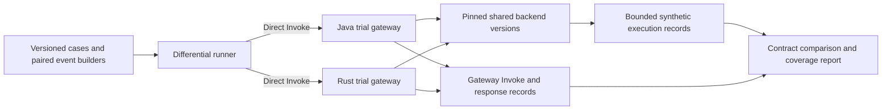

# Java and Rust Lambda gateway parity test suite

Date: 2026-10-22.

Status: incrementally implemented; selected local and AWS profiles qualified.
Full suite/WP12/WP13 remain incomplete. This document authorizes no AWS changes.

Historical initial implementation checkpoint (2026-10-22): the initial stages 1–2 local batch is
implemented in `light-example-rs/tests/lambda-parity`, reusing
`apps/lambda-trial-backend` and both existing result-v1 runners. The current batch
selects 14 of 25 inventory cases; deferred/unavailable entries remain explicit.
It exercises real Java/Rust Init/service paths with injected dependencies and
separately tests the actual backend executable through an owned Runtime API.
It does not establish gateway SDK dispatch into that executable, paired RIE,
AWS execution accounting or the full matrix below. See the suite README for the
current build/rerun commands. Stage 3 and AWS cleanup remain separate decisions.

## Current measured parity matrix — 2026-10-24

[Per-case qualification and eleven-entry reconciliation](/home/steve/workspace/light-example-rs/tests/lambda-parity/QUALIFICATION-MATRIX.md), [new local implementation/evidence](/home/steve/workspace/artifacts/implementation/light-lambda/parity-next-local-20261023T035300Z/REPORT.md).

| Profile | Independent expectations | Approved selected contracts | Raw byte identity | Actual execution evidence |
|---|---|---|---|---|
| Pet-store ten-case |20/20|10/10 pairs|0/10|Named comparison backend/JWKS counts unmeasured; independent from synthetic totals|
| Synthetic version2 response/forwarding/routing |44/44 requests;28/28 case expectations|14/14 case pairs,22/22 steps|0 cases/steps|42 entries/completions/received events; independent per-gateway forwarding expectations; route-miss zero dispatch|
| AWS IAM/deadline/recovery |4 direct +4 primes +18 selected, all pass|9/9 paired steps|0/9|20/18 downstream including primes;16/14 selected; denied0; actual platform timeout/late completion and warm streams|
| Separate status-format candidate, local FunctionError/invalid envelopes |22/22; prior Java failure evidence retained|11/11 frozen paired contracts|0/11|22 actual entries/20 completions; broader shared-state defect remains open|
| New local Specification/JWT/scope/proxy |28/28|14/14 declared side-specific step assertions; full-field differential beyond those assertions not claimed|0/14|20 entries/18 completions/20 received records;1 JWKS GET per side;8 zero-dispatch auth/scope rejections|
| [Local dynamic echo](/home/steve/workspace/artifacts/implementation/light-lambda/parity-dynamic-echo-20261024/REPORT.md) |14/14|7/7 side-specific contracts|0/7|14 unique backend executions/completions/received records; independent echo/received goldens, A/B/A warm isolation and bounded400/recovery; no new package or AWS run|
| [Local target routes](/home/steve/workspace/artifacts/implementation/light-lambda/parity-routes-20261024/REPORT.md) |40/40 v2; shared v1 preserved34/40|20/20 side-specific contracts|0/20|28 actual executions/completions;12 zero-dispatch rejections; R-01a native wildcard/Rust longest-template difference retained; two textual config orders and warm recovery|
| [Local middleware composition](/home/steve/workspace/artifacts/implementation/light-lambda/parity-composition-20261024/REPORT.md) |30/30 functional (Java10/Rust20), plus2 service gates|not claimed; native Transformer functionality remains unqualified|not measured|22 unique executions/completions;8 functional zero-dispatch cases plus2 service-only rejections; order/path/error/warm checks;9 processes reaped|
| S5 AWS error/JWT, historical failed scope |39/50; error subset22/22 and Rust JWT14/14|14/25 aggregate; error subset11/11|0/25|32/29 backend executions/completions and1 JWKS against required42/38/2; Java TLS failure retained|
| S6 Java PKIX, historical failed scope |3/14;11 failures|not paired|not measured; Java-only|13 actual JWKS executions,0 accepted fetch records; strict-handler404; no successful warm recovery|
| [S7 Java configuration recovery](/home/steve/workspace/artifacts/implementation/light-lambda/java-jwks-admission-local-20261024T020942Z/s7-completed-aws/REPORT.md) |14/14, once-only|not paired; Java-only expectations|not measured; Java-only|10 unique backend executions,9 completions,10 received records,1 measured JWKS execution/accepted fetch/completion; one warm gateway stream; independent offline audit passed|

These scopes overlap and are not additive parity totals. S7 preserves the Java executable, strict JWKS handler, reviewed PKIX/JKS and validation behavior; its only behavior correction explicitly clears both inherited JWKS Basic credentials. The final layer hash is `308b24e9192d0a1661496d774f15443422b15757a4e2f825729f4db1e403f3c4`. Java's absence of issuer enforcement is the settled S-04a difference; the failed additional issuer control remains failed. S7 is not a replay or repair of S5/S6 evidence and establishes no new Java/Rust paired parity or byte identity.

Current handoff: [S7 raw-evidence audit](/home/steve/workspace/artifacts/implementation/light-lambda/java-jwks-admission-local-20261024T020942Z/s7-completed-aws/OFFLINE-AUDIT.json). Local dynamic echo14/14 and target-route v2 selection40/40 are now qualified through the existing harness; the selected composition subset now passes30 functional checks; native RuleExecutor/action-profile qualification remains a concrete gap. Cleanup requires a separate explicit decision; public JWKS trial endpoints remain active and potentially chargeable. No reruns, deployments or cleanup occur in this reporting update.

Of the eleven original open declarations, six now have named-subset coverage, one has partial composition/native-profile coverage, one has a demonstrated Java production defect, two retain platform/provenance/activation gates, and one retains a JSON-runtime capability deferral. Original default-runner selection metadata and all expectations remain intact. Byte identity never substitutes for independent expectation/approved-contract checks. Current cleanup inventory is a separate decision with no deletion authorization. Original Java D03 assertion conflict, broader exchange-state defect and unmeasured AWS SDK-wire behavior remain open; no worker execution or new AWS actions were performed for this update.

## Objective and scope

Build a repeatable suite that sends equivalent requests through Java
`light-lambda-native` and Rust `light-lambda`, invokes the same controlled business
Lambda versions, and explains every observable difference. Retain the existing
Java pet-store functions as an independent compatibility baseline. Extend the
existing `lambda-trial-backend` where practical rather than reimplementing
pet-store or creating a function for every response case.

The product under test is a **Lambda function acting as a gateway**, including
the handlers used by `light-lambda-native`. The broader light-4j catalogue is not
an additional porting requirement. Backend tests complement, rather than replace,
handler unit tests, configuration admission, existing conformance fixtures and
package/RIE qualification.

The initial AWS trial uses the console Test button or synchronous SDK/CLI Invoke.
Direct Invoke passes the supplied JSON unchanged; it supplies no HTTP ingress
conversion. The runner must construct the envelope supported by each gateway.
No ALB, API Gateway, Function URL, public endpoint, VPC attachment, certificate or
DNS is required. This is an additional test topology alongside the ALB deployment
in the [product design](design.md), not qualification of ALB or another ingress.

Existing Rust qualification, as reported at design time, covers a supported
subset. Validator activation and Router rewriting remain unavailable; related
worker execution is paused. Traceability has separate instrumented evidence.
The observability candidate is distinct from the accepted release. Reconcile
these statuses against the implementation handoff before each run; none is
silently promoted by this design.

## Architecture



Use dedicated gateway trial configurations for this suite. Preserve accepted
gateway deployments, original pet-store functions, original fixtures and prior
failed evidence. Both gateway roles invoke the same qualified backend ARNs.
Record actual versions, code hashes, configuration/layer identities and role
policy snapshots. Do not compare Java against backend version A and Rust against
version B. Use published immutable backend versions initially; an alias is
acceptable only if its resolved version is checked before and after the run and
no weighted routing is configured.

Local fake-dependency and RIE runs precede AWS execution. They prove packaging,
application behavior and runner contracts, but not IAM denial, Lambda platform
timeouts, freeze/thaw or actual backend execution on AWS.

## Backend functions

Start with two identities from one backend implementation and artifact. Add the
delay and denied targets when their tests are ready.

| Logical function | Purpose | Distinct configuration |
| --- | --- | --- |
| `parity-echo-a` | Echo, controlled response envelopes, application errors and FunctionError | Fixed backend identity `echo-a` |
| `parity-echo-b` | Detect wrong routing, stale target selection and cross-request contamination | Same artifact as A, identity `echo-b` |
| `parity-delay` | Queue/invocation deadline, delayed success and timeout scenarios | Explicit bounded delay modes and separately recorded function timeout |
| `parity-denied` | Real AWS Invoke authorization failure | Existing valid version excluded from both gateway execution roles |

The names are logical defaults; deployments add a unique trial prefix. Do not
add a permissive resource policy to the denied function. A missing-function test
is separate from a denied-permission test and may require different IAM scope;
do not broaden IAM implicitly to make it executable.

Keep these functions nonpersistent and without outbound service calls. They need
only their own log permissions. No arbitrary URL fetching, code execution, file
access or unbounded allocation/delay belongs in a backend mode.

### Control and echo contract

Use a reserved synthetic request header such as `x-parity-case` to choose a
finite, versioned mode. A deployment-owned mode table defines responses and
delay/body limits. Unknown modes or ambiguous duplicate control values return a
fixed error. Do not accept arbitrary response scripts or resource limits from
events. Header transformations under test must explicitly account for these
control headers; no assumption that every chain preserves them is allowed.

For normal responses, the backend returns the existing native business-function
response envelope. Echo only a case-specific allowlist:

- method, path and resource/path-parameter fields;
- raw query fields and their single-/multi-value representations;
- selected synthetic headers and relevant presence/absence;
- body bytes and base64 flag, bounded by the profile;
- fixed backend identity and deployed version.

Never echo or log Authorization, cookies, JWTs, credentials, arbitrary identity
claims or an entire incoming event. Token-related cases use synthetic nonsecret
markers where possible; authenticated gateway tests acquire test credentials
outside saved fixtures. Credential fields are excluded before serialization,
not removed later from a report.

Separate these backend behaviors:

1. **Normal envelope:** configurable finite statuses, headers and body cases.
2. **Application HTTP error:** successful Lambda execution returning, for example,
   a response envelope with HTTP status 500.
3. **FunctionError:** deliberate unhandled synthetic exception from the runtime;
   returning a JSON property named `FunctionError` is not equivalent.
4. **Invalid envelope:** syntactically valid Lambda result with wrong shape,
   missing/wrongly typed fields, invalid base64 or invalid nested body content.
5. **Invalid outer payload:** only where the chosen runtime can actually produce
   invalid response bytes. Do not claim it from returning a JSON string. Keep
   unsupported modes local-only or deferred with an explicit reason.

The backend implementation language is not part of gateway parity. Prefer
extending the existing trial backend and retain its proven FunctionError path.
Validate its contract directly before using it as an oracle for either gateway.

## Case matrix

Each family includes successful recovery after a failure. Introduce cases in
small batches with declared expected results, not by collecting output and then
making that output the expectation.

| Family | Initial cases | Key observations |
| --- | --- | --- |
| Routing | Four pet routes; echo A/B; unknown route; literal/template selection | Correct target/version; invocation cardinality; no dispatch on rejection |
| Request forwarding | Method/path; Unicode; repeated/empty query values; percent encoding and `+`; header casing/multiplicity | Exact forwarded fields and body bytes; documented Java/Rust envelope differences |
| Body handling | Absent, null, empty string, JSON, Unicode and binary/base64 | Presence preserved where required; decoding count; invalid-input behavior |
| Responses | 200/201/204; application 4xx/5xx; empty body; repeated headers/Set-Cookie; binary | Status, header multimap, body bytes, encoding and public error contract |
| Backend failure | FunctionError; wrong envelope types; missing fields; malformed nested JSON; invalid base64 | Gateway mapping and privacy; HTTP 500 distinct from FunctionError |
| AWS dispatch | Denied invocation; known qualified targets | Real IAM result; no backend execution on denial; no alternate target fallback |
| Middleware | Authentication, scopes, headers, transformations, sanitizer, limiter, CORS | Real chain behavior and ordering; rejection before dispatch |
| Composition | Competing failures; late policy rejection; request/response transforms | Correct first applicable error and side effects; exactly-once completion |
| Timing | Immediate deadline exhaustion; bounded delay; Lambda timeout | Declared gateway-versus-function timeout ordering; late-result isolation |
| Recovery | Valid → failure → valid; alternating A/B and synthetic identities | No stale target/body/header/principal state; expected call counts |
| Deferred capability | Validator, rewrite-dependent Router profiles, unsupported admin/cache profiles | Explicit unavailable/deferred result; never converted into a pass |

Retain pet-store runs separately from synthetic-suite totals. A passing synthetic
backend case does not prove an unchanged deployed Java business function accepts
the forwarded payload. Existing intentional differences, including ingress
requirements and approved error mappings, remain versioned decisions.

Warm sequential invocation alone does not prove reuse of one execution
environment. Use an existing safe environment identity or a separately reviewed
observation to demonstrate reuse. Without it, label evidence “sequential
recovery; environment reuse unconfirmed.” Concurrency, freeze/thaw, load and
performance are later profiles, not prerequisites for the first parity batch.

## Fixture and result contracts

Extend the existing serverless-conformance runner and result-v1 contracts where
possible. Do not create an unrelated comparison framework. Place suite-specific
execution metadata and backend evidence in a versioned sidecar if result-v1
cannot represent it; validate the sidecar and link it by digest.

A case contains:

| Field | Meaning |
| --- | --- |
| `id`, `schemaVersion` | Stable case identity and validated schema version |
| `family`, `requiredCapabilities` | Inventory classification, required handlers and backend mode |
| `logicalRequest` | Synthetic method/path/query/header/body input shared by both sides |
| `javaEvent`, `rustEvent` | Exact generated envelopes or pinned event files with hashes |
| `profile` | Named gateway chain/configuration and backend mode/version requirements |
| `expectJava`, `expectRust` | Independent contract assertions; shared expectation where equivalent |
| `differences` | Exact approved fields, rationale and approval/ledger reference |
| `dispatch` | Expected target identity and per-side execution count/range |
| `sequence`, `timing` | Ordered recovery steps and approved timing constraints, if applicable |
| `observations` | Required evidence and explicit nondeterministic fields |

Existing fixture schemas take precedence over these descriptive field names.
Document the mapping rather than mechanically adding incompatible keys.

Generate paired events from one logical case. Pin and preserve both raw inputs.
Only explicitly declared adapter differences may differ between them. If Java
cannot represent repeated fields in its accepted envelope, record that limitation
instead of silently collapsing the Rust input. A synthetic ALB discriminator
used for direct Invoke does not establish that an ALB sent the request.

Authenticated runs require credentials valid for the selected gateways. Use one
token only when issuer/audience/scope contracts support it; otherwise use paired
test tokens with equivalent authorized claims and record the distinction without
storing token values. Do not weaken either gateway's authorization contract.

### Comparison rules

1. Check the outer SDK/CLI invocation outcome, including Lambda FunctionError,
   separately from the returned gateway status. A successful Invoke API call is
   not an application success.
2. Check each gateway independently against its expectation before comparing
   Java to Rust. Two implementations producing the same wrong result is a fail.
3. Compare status, declared headers, body bytes, encoding, backend target,
   forwarded event subset, execution counts and relevant side effects.
4. Header names compare case-insensitively; values and per-name ordering remain
   exact unless the case has an approved rule. Preserve repeated Set-Cookie.
5. Default body comparison is byte-exact. JSON-semantic comparison is allowed
   only for explicitly selected cases, with a precision-preserving parser;
   never erase error-format or numeric-precision differences globally.
6. Normalize only named nondeterministic fields such as generated request IDs.
   Preserve raw results with approved secret redaction and record every
   normalization. Never sort observed dispatch/fetch order to hide differences.
7. Timing cases declare boundaries and tolerances before execution. Preserve
   exact historical failures such as the native 60s/59s reset observation; use
   additive clock-qualified cases rather than changing the old assertion.
8. An intentional-difference case passes only when both expectations and the
   declared differences match. A stale declared difference is a conflict.

Use distinct outcomes: `equivalent-pass`, `intentional-difference-pass`, `fail`,
`blocked`, `unavailable`, `deferred`, `not-selected` and `inconclusive-evidence`.
Keep existing single-runner `skipped` semantics confined to that contract.
Reports include selected/total counts and reasons. A selected required case that
cannot execute or lacks required evidence makes the run non-green. An inventory
listing alone is not a qualification run. A subset pass never means full parity.

## Execution counts and correlation

Generate a bounded opaque run ID, case ID and per-side attempt ID. Carry only
synthetic identifiers across the gateway/backend boundary. For each backend
execution, emit one bounded record at handler entry containing those IDs, backend
identity/version and the Lambda execution request ID from runtime context.
Emit a matching completion record when possible. Do not assume a timeout or
FunctionError produces a completion record.

Runner retries are disabled for the initial paired run; configure and record SDK
retry behavior. Gateway retry behavior remains the approved production behavior.
If an SDK outcome is ambiguous, collect evidence before rerunning. A rerun gets a
new attempt ID and never replaces failed evidence.

Count distinct backend execution request IDs for a case, not number of log lines
or gateway successes. Compare them with expected target and cardinality. Duplicate
log delivery must not look like duplicate execution. An Invoke API response ID is
not a backend execution ID unless that relationship is separately demonstrated.
Likewise JWKS client-send events do not count hidden wire retries or successful
authentication.

CloudWatch delivery is asynchronous. Use a documented bounded collection window,
deduplication and a positive control proving records arrive from the intended
version/log stream. Missing records are not automatically proof of zero calls.
If required evidence is incomplete, mark the case inconclusive. Combine negative
dispatch evidence with gateway terminal observations and local owned-dependency
counts; report the limits of AWS log-based absence claims. Do not add a persistent
receipt service solely to make the first suite pass; propose it separately if
stronger durable execution accounting becomes necessary.

Instrumentation that is absent from the accepted gateway requires a separately
identified candidate. Never attribute its measurements to an unchanged release.
Record observability configuration and ensure sensitive surrounding span fields
cannot bypass the privacy policy.

## Deployment and operation

The runner uses an explicit AWS profile/session and verifies account and region
against the run manifest before mutations or invocation. Never store access keys
in fixtures. The initial existing trial is in account `964637446810`, region
`us-east-2`; keep deployment code parameterized and require explicit selection.

The deployment manifest lists:

- gateway ARNs, resolved versions, ZIP/code hashes, config digests and layer versions;
- backend qualified ARNs, shared artifact digest, mode-table version, architecture,
  memory, timeout and environment configuration;
- exact IAM permissions, denied-target exclusion and test-runner permissions;
- synthetic data policy, log retention, resource ownership and cleanup scope;
- bounded test count, concurrency, delays, payload sizes, evidence deadline and
  estimated charges. Budget alerts are not spending caps.

Gateway roles receive Invoke permission only for the intended allowed target
versions and required logging permissions. The runner receives separately scoped
Invoke/read-log privileges. Creating deployment resources may require a different
role; do not give deployment rights to gateway execution roles.

No public endpoint or unauthenticated public permission is created. Invoke is
authenticated by AWS IAM even when the gateway's application JWT profile is
disabled. JWT-enabled and application-authentication-disabled profiles have
separate results.

Before any AWS deployment or live invocation, present the exact named resources,
artifacts, permissions, test cases and cleanup plan for owner authorization.
Do not reuse broad previous approvals for a new deployment. Permanent cleanup
requires the applicable action-time confirmation. Preserve accepted gateways,
pet-store functions, shared resources and comparison evidence. Delete only
trial-owned resources after comparison/measurement is complete.

## Suggested implementation layout and commands

Use the existing Light Lambda worktree and adapt existing directories where
equivalent tooling already exists. These are proposed locations, not claims of
implemented commands:

```text
apps/light-lambda/tests/parity/
  README.md
  cases/                      # Additive cases and capability inventory
  profiles/                   # Explicit Java/Rust configuration adaptations
  schemas/                    # Suite manifest/evidence schema, if needed
  run.py                      # Thin orchestration over existing runners
apps/light-lambda/deploy/parity/
  template.yaml
  parameters.example.json
  runbook.md
```

Extend the current `lambda-trial-backend` at its actual repository location;
record that location and build identity rather than copying its source into
another tree. Reuse existing local/RIE harnesses, generated test credentials,
comparison rules and artifact validators.

Provide documented commands to validate inventory, build/test the backend,
generate paired events, run local/RIE cases, prepare AWS deployment, execute an
explicit case selection, collect evidence and compare a saved run. Offline
preparation must never silently invoke AWS. Write evidence to a fresh directory
under `/home/steve/workspace/artifacts/implementation/light-lambda/`; preserve
earlier runs and manifests.

## Delivery sequence and exit criteria

### 1. Matrix and backend contract

Inventory existing fixtures and modes; define the first cases and approved
differences. Extend echo A/B modes and direct backend tests. Exit: backend
responses, synthetic exceptions, bounds and privacy are locally tested, with no
changes to original pet-store or fixture expectations.

### 2. Local paired runner

Implement shared logical cases, per-gateway event generation and comparison on
real application paths. Reuse Java runner and Rust Init/service/RIE support.
Exit: route selection, forwarding, normal/error response and recovery cases pass
or have exact recorded defects; selected unsupported cases cannot appear green.

### 3. First AWS parity batch

Prepare and obtain approval for echo A/B and separate gateway trial profiles.
Deploy pinned versions, prove backend modes directly, then run the same selected
cases through both gateways. Exit: independent expectations, differential
results, target identities and execution evidence are available for every case.
Record any unresolved execution-count evidence rather than inferring success.

### 4. IAM and timing batch

Add denied and delay targets with separate resource configuration and approval.
Test denial, timeout/deadline behavior and recovery. Exit: declared outcomes and
side effects hold with recorded timing/evidence limits. Do not change historical
timing expectations or introduce retries to obtain green results.

### 5. Incremental handler migration

Add supported handler families and full representative chains. Bring Validator
and Router rewriting into this suite only after their implementation, activation
and execution gates are resolved. No worker experiments are resumed or replaced
by this design. Preserve approved security/privacy boundaries.

Each batch delivers code, exact commands, pinned artifacts, a per-case result
table and remaining blockers. Full-suite parity requires every required case to
be equivalent or an approved intentional difference with no missing evidence;
explicit deferrals remain disclosed. This does not by itself qualify public
ingress, customer production configuration, performance or all of WP12/WP13.

## First assignment for implementation

Implement stages 1 and 2 first. Identify the existing backend and runner code,
reuse it, and produce the reviewed case matrix plus executable local tests.
Prepare stage 3 IaC and a concrete AWS scope for review, without deploying.
Keep implementation focused on a reusable parity suite rather than another
round of baseline-only evidence. Report production defects separately from
runner defects, unavailable capabilities and intentional differences.

### Local status-format mitigation qualification — 2026-10-23

[Report](/home/steve/workspace/artifacts/implementation/light-lambda/parity-java-status-format-20261023T061219Z/REPORT.md). Additional approved typed-format guard qualifies only top-level malformed Integer status parsing on separate Java ZIP122d03391f999aad4f6ccf022c0fb1188241c2218c670ff013aa884510033db7. Error22/22, JWT28/28, owned-stub12/12 and preserved fourteen-case44/44 local requests pass. Native mitigation profile261 reported/257 passed/4 preexisting disabled; original contract retains exactly one D03 conflict. Shared exchange/chain, unrelated parsing behavior and original expectations remain unchanged. No AWS rerun, deployment, accepted-release replacement or paused work; byte identity stays separate and SDK-wire AWS behavior stays unmeasured.
